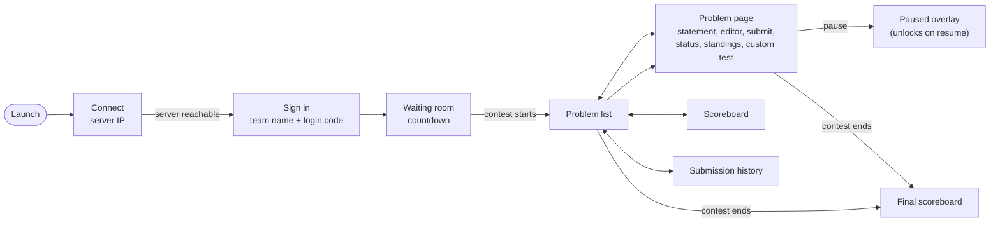

# CampusCode Client

The participant app for [CampusCode](#part-of-campuscode) contests. Teams install it on their own laptop and use it to connect to the contest server, read problems, write and submit code, and follow the live scoreboard. It runs full-screen, locked down for the duration of the contest.

## Part of CampusCode

| Repo | What it does |
|---|---|
| [CampusCode-Cloud](../CampusCode-Cloud) | Organisers author a contest there and download the bundle to run it. Participants download this app there. |
| [CampusCode-Server](../CampusCode-Server) | Runs the contest offline on the organiser's laptop: judging, scoreboard, admin dashboard |
| **CampusCode-Client** (this repo) | The participant app |

## Get the app

Download the installer for your platform from the CampusCode Cloud app's **Download Participant App** page:

**<http://65.0.183.82:8081>**

Windows, macOS (Intel) and macOS (Apple Silicon) are available. Install it **before contest day**, because the download needs internet and the contest itself runs on a local network.

**On a Mac:** the app isn't signed with an Apple Developer certificate. The first time, right-click it and choose **Open**, not double-click.

## Joining a contest

1. **Connect.** Enter the server IP address your organiser gives you. The app checks that the server is reachable and remembers the address.
2. **Sign in** with your team name and login code. Your organiser registers the team and gives you the code.
3. **Wait for the start.** The waiting room shows a countdown and moves you to the problems automatically when the contest goes live.
4. **Solve problems**, submit, and watch the scoreboard until the contest ends. You're taken to the final scoreboard automatically when it does.

## What's in the app

- **Problem list and statements.** Statements are rendered from Markdown, with time and memory limits shown for each problem.
- **Code editor.** A full Monaco editor (the editor from VS Code) for **C++, Python and Java**. Your code is saved as a draft per problem and language, so switching languages or problems never loses work.
- **Submit.** Submissions are judged by the contest server. The app polls and shows your verdict as soon as it's ready: Accepted, Wrong Answer, Time Limit Exceeded, Runtime Error, Compilation Error or Internal Error.
- **Custom test.** Run your current code against your own input and see the output. Nothing here is judged or saved.
- **Status and history.** See every submission you've made for a problem, or across all problems. Open any row to view the code you submitted.
- **Live scoreboard.** Standings update the moment a submission is judged. A Standings tab inside each problem page shows the same ranking without leaving the editor.
- **Live contest timer.** The countdown is synced with the server's clock. If the organiser pauses the contest, the screen locks with a "Contest Paused" overlay and unlocks when it resumes.
- **Resilient connection.** If the server goes away briefly, the app reconnects on its own with backoff. If you were mid-submission, you can still find it in your Status tab.
- **Light and dark themes.**

## Contest lockdown

Packaged builds run in kiosk mode for the duration of the contest:

- Full-screen, with minimising and resizing disabled.
- Developer tools are blocked, including the F12 and Ctrl+Shift+I/J shortcuts, and the default application menu is removed.
- Links and pop-up windows can't navigate away from the app.
- The app refuses to start if it's launched with debugging or remote-inspection flags.

Some things can't be locked down from inside an app. Operating systems reserve **Alt+Tab** and **Cmd+Tab**, and quitting the app is deliberately left possible. Blocking copy-paste, intercepting Cmd+Q and handling multiple displays aren't implemented yet.

## Device binding

Each installation has a stable device ID, and your team is bound to the first device that signs in. If you sign in from another laptop, the login is refused and your organiser gets an override request to approve. Once they approve it, you can sign in on the new device.

## Tech

Electron with a React and Vite front end, the Monaco editor, and `react-markdown`. Installers are built for macOS and Windows with `electron-builder`. A GitHub Actions workflow ([.github/workflows/build.yml](.github/workflows/build.yml)) builds them on both platforms from a `v*` tag or a manual run.
